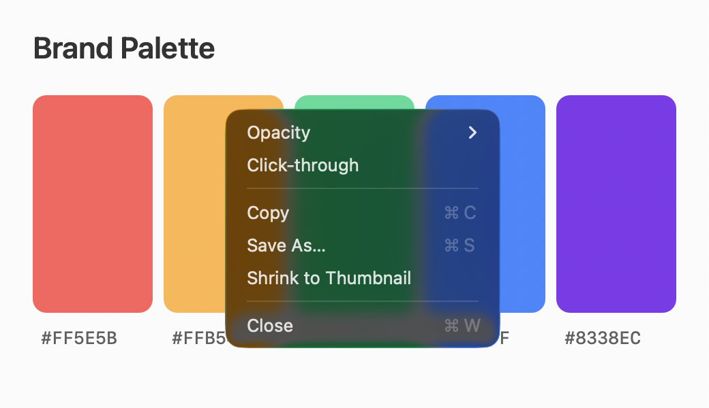
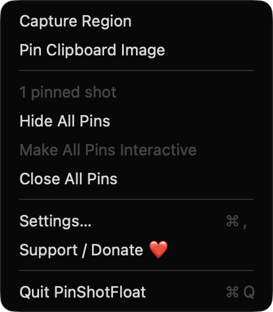
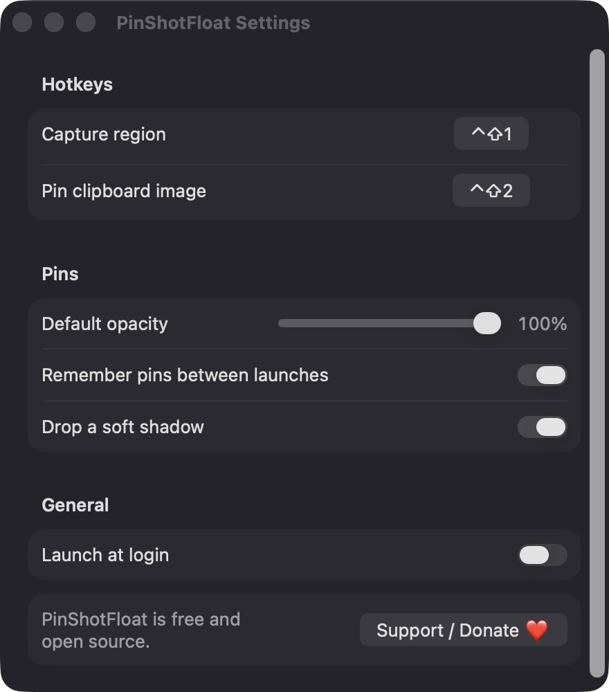

# PinShotFloat

**🌐 Website:** [turhe123.github.io/pin-shot-float](https://turhe123.github.io/pin-shot-float/)

Capture a region and pin it as a floating, always-on-top reference window you can resize and fade.

> 🆓 A free, open-source **ScreenFloat alternative** for macOS 14+. Native Swift, no accounts, no subscriptions, MIT licensed.


[](https://github.com/turhe123/pin-shot-float/releases/latest)

## Why

PinShotFloat is a free, open-source, 100% native, backend-free alternative to paid utilities in the *Menu Bar Utility* category. It was inspired by ScreenFloat ($15.99 one-time) and covers just the pinning part: capture, float, adjust and dismiss. It runs entirely on your Mac, with no accounts, servers or network access.

## Features

- **Menu bar app** with no Dock icon (`LSUIElement`).
- **Capture Region** with a global hotkey (default `⌃⇧1`). A dimmed overlay appears on every display. Drag to select, and press Esc or right-click to cancel. Capture uses ScreenCaptureKit at the display's native (Retina) resolution.
- **Pin Clipboard Image** with a global hotkey (default `⌃⇧2`). It accepts anything `NSImage` can read from the clipboard (PNG, TIFF, JPEG, PDF) and centres the pin on the mouse pointer, scaled to fit the screen.
- **Pins appear where the pixels were taken**, as borderless, non-activating floating panels. They show on all Spaces and over full-screen apps.
- **Drag** a pin by its body. **Resize** it from its edges with the aspect ratio locked.
- **Opacity**: Option-scroll over a pin, or use the right-click Opacity submenu (25 / 50 / 75 / 100 % and a slider). The minimum is 10 %.
- **Click-through** mode lets the mouse pass to the windows underneath. "Make All Pins Interactive" in the menu bar always brings interaction back.
- **Thumbnail**: double-click a pin, or choose Shrink to Thumbnail, to flip it to a small size and back.
- **Copy** a pin back to the clipboard, **Save As…** to PNG (failures show an alert with the reason), or **Close** it (Esc closes the focused pin).
- **Show / Hide All Pins** and **Close All Pins** from the menu bar.
- **Remember pins between launches** (optional), stored as PNG files plus a JSON manifest in `~/Library/Application Support/PinShotFloat/Pins`.
- **Settings**: rebindable hotkeys, default opacity, remember pins, soft drop shadow, launch at login.
- **Safeguards**: up to 30 pins at once (with a warning at the limit). Pins on displays that disappear move to the main display. Temporary files are cleaned at quit.

## Screenshots

<p align="center"></p>

<p align="center"><em>A pinned image floats above other windows, and its right-click menu offers opacity, click-through, copy, save, thumbnail and close.</em></p>

<p align="center"></p>

<p align="center"><em>The menu bar menu lets you capture a region, pin the clipboard image and show, hide or close all pins.</em></p>

<p align="center"></p>

<p align="center"><em>Settings let you rebind the hotkeys, set the default opacity, remember pins between launches, add a soft shadow and launch at login.</em></p>

## Install

1. Download `PinShotFloat-macOS.zip` from the [latest release](https://github.com/turhe123/pin-shot-float/releases/latest).
2. Unzip it and move `PinShotFloat.app` to `/Applications`.
3. The app is open source and not notarized, so clear the quarantine flag:

   ```bash
   xattr -cr /Applications/PinShotFloat.app
   ```

4. Right-click the app and choose **Open** the first time you launch it.

## Build from source

Requires macOS 14+ and Xcode with Swift 5.9+.

```bash
brew install xcodegen
xcodegen generate
xcodebuild -project PinShotFloat.xcodeproj -scheme PinShotFloat -configuration Release -derivedDataPath ./build build
```

The app is produced at `build/Build/Products/Release/PinShotFloat.app`.

## Permissions

- **Screen Recording**: needed to capture a region of the screen. It is requested the first time you capture. An explanatory dialog has a button that opens System Settings › Privacy & Security › Screen & System Audio Recording. You may need to relaunch the app after enabling it. Captured pixels stay on your Mac.
- **Login item** (optional): only if you turn on "Launch at login" in Settings, via `SMAppService`.
- **File access**: only the locations you choose in Save As, plus the app's own Application Support folder for remembered pins.

PinShotFloat does not request Accessibility or Microphone access. Global hotkeys use the Carbon hot key API, which needs no Accessibility permission.

## Support ❤️

PinShotFloat is free. If it saves you time, you can support its development:

[%20Davidai%20%E2%9D%A4%EF%B8%8F-ff5e5b?logo=ko-fi&logoColor=white)](https://ko-fi.com/leodavidai)

There is also a "Support / Donate ❤️" button in the menu bar and in Settings.

## More free Mac apps

PinShotFloat is one of [60 free, open-source Mac utilities](https://github.com/turhe123/mac-apps) built the same way: native Swift, no accounts, no telemetry. Browse the full gallery at [turhe123.github.io/mac-apps](https://turhe123.github.io/mac-apps/).

## License

MIT © Or Davidai Bachar
